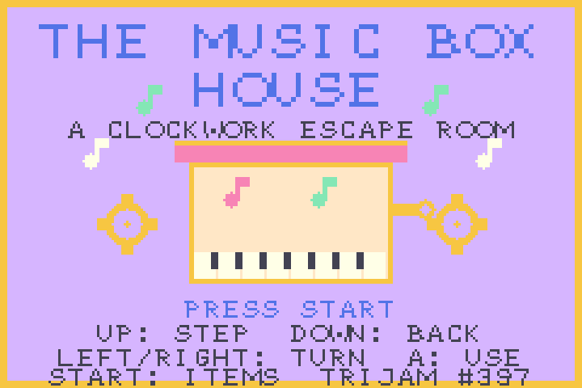

# The Music Box House

A clockwork escape room for the Game Boy Advance. You wake up locked
inside a house that is itself a giant music box — and the only way out
is to play it.



## Play

Play it in your browser on [itch.io](https://retroromrunner.itch.io/music-box-house),
or download the ROM and run it in any Game Boy Advance emulator
(mGBA, RetroArch) or on real hardware with a flash cart:
**[music-box-house.gba](build/music-box-house.gba)**

## The house

Seven little rooms, each with one job — and the house runs on music.

- **The Winding Room** — turn four gear dials until they all sing the
  same note, and find the Brass Key.
- **The Sheet-Music Library** — hear the song, then play it back on
  the note stands.
- **The Gear Gallery** — pull three levers in order, big to little.
- **The Piano Parlor** — play the scale, low to high, and the lid lifts.
- **The Bell Tower** — ring the bells low, middle, high, middle, low,
  and the tune grows with every correct bell.
- **The Melody Room** — hear a melody once, then play it back on the
  piano keys.
- **The Music-Box Core** — fit the Tuning Fork and the Final Key into
  the core, and the house plays its whole song at last.

One locked chest waits back in the Winding Room — the Clock Key from
the Bell Tower opens it, and the Final Key inside is the last piece
of the way out.

## Listen closely

Sound is the puzzle here, not decoration. Every gear plays the note
of the direction it points to. Every pickup has its own little
jingle, so you can learn items by ear. Hint notes play their melody
for you — read one, listen, then play it back. A wrong note still
plays its own pitch first, so you always learn what each key, stand,
and bell sounds like. Solve a puzzle and the house plays the whole
melody back for you, then a bright little jingle up the scale.

A slow music-box waltz in D minor drifts through the title screen,
and when the exit finally opens, the waltz comes back in major —
the music box playing its whole song.

## Controls

- D-pad: Up step, Down back, Left / Right turn
- A: use / interact
- Start: inventory
- Select: minimap

Movement is instant, tile by tile — no smooth scrolling, so it stays
quick and readable even on a phone emulator.

## Build

```sh
./build.sh
```

Requires `arm-none-eabi-gcc` on your PATH. The build produces
`music-box-house.gba` (32 KB).

## Credits

Designer. Made for Trijam #397, theme: Escape Room.

AI Disclosure: AI Assisted, Code and Sounds.
